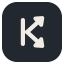
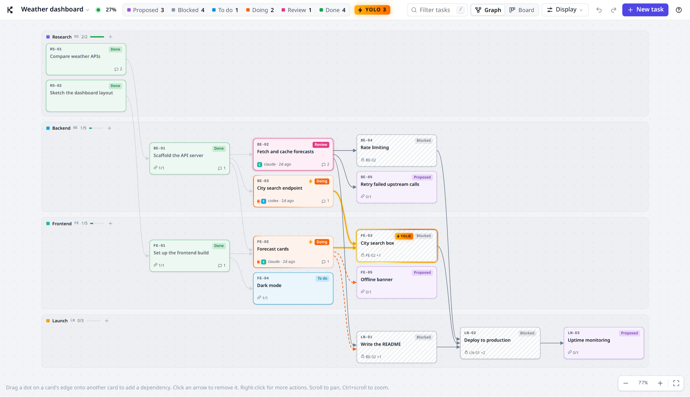
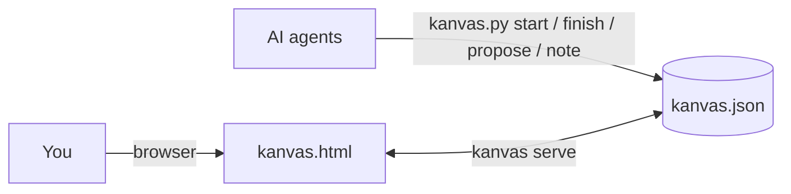
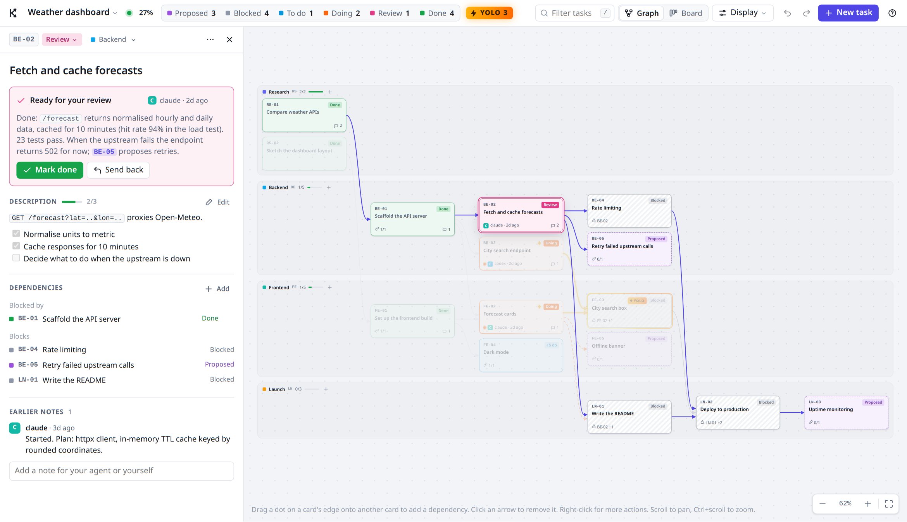
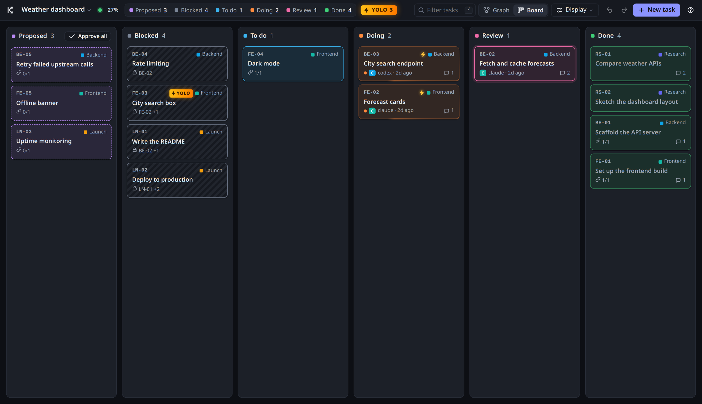

# Kanvas

A task board you share with your AI coding agents. Agents plan and report through a small CLI; you approve, steer and review in an interactive board in your browser.

One JSON file, one Python script, one HTML page. No accounts, no build step, no dependencies.



## Why

AI agents do their best work in a terminal, but a project needs a plan that outlives a single chat: what is left, what depends on what, what was decided and why. Kanvas keeps that plan in `kanvas.json` next to your code, where you and any number of agents work on it together.

- **You stay in control.** Agents propose tasks and you approve them. Agents finish tasks and you review them. Only you mark work done, unless you hand a chain of tasks over with YOLO, and even then the task at its end comes back to you for review.
- **Agents cannot break the board.** They change it through `kanvas.py`, which enforces the workflow and rejects invalid moves with a clear message.
- **Live.** Agent changes appear in the browser within a second, and your edits are on disk immediately for the agent's next command.
- **Agent-agnostic.** Claude Code, Codex, Cursor, Gemini CLI, OpenCode, GitHub Copilot, or anything that runs shell commands. Use several at once; notes record who did what.
- **Git-friendly.** The board is plain, stably formatted JSON. Commit it with the code and your history shows how the plan evolved.

## Quick start

Kanvas works on Linux, macOS and Windows. You need a browser and [uv](https://docs.astral.sh/uv/), which installs Kanvas and downloads Python too if your computer has none.

**1. Install uv** (once). On macOS and Linux, run this in a terminal:

```bash
curl -LsSf https://astral.sh/uv/install.sh | sh
```

On Windows, run this in PowerShell:

```powershell
powershell -ExecutionPolicy ByPass -c "irm https://astral.sh/uv/install.ps1 | iex"
```

Then close the terminal and open a new one.

**2. Install Kanvas** (once):

```bash
uv tool install kanvas-board
```

This gives you the `kanvas` command. If the terminal later cannot find it, run `uv tool update-shell` and open a new terminal.

**3. Open the board.** Go to your project's folder and run:

```bash
cd path/to/your-project
kanvas init
kanvas serve
```

`init` creates the board, `kanvas.json`, and installs the agent skill in `.agents/skills/kanvas/`: instructions for your agents and their own copy of Kanvas, so agents need nothing installed. Commit `kanvas.json` and `.agents/` with your project.

Agents that support skills pick the skill up automatically, and `init` creates an `AGENTS.md` that points the others to it. If your project already has an `AGENTS.md`, `init` leaves it untouched and, when the file does not mention the skill yet, prints this line for you to add:

```
Plan and track work on the Kanvas board; follow .agents/skills/kanvas/SKILL.md.
```

`serve` opens the board in your browser. Keep it running while you work; Ctrl+C stops it.

**4. Ask your agent:**

> Interview me about this project and plan it on the Kanvas board.

The plan arrives as proposals. Approve the ones you want, and tell the agent to start working.

### Let your agent set it up

With uv installed (step 1), you can hand steps 2 to 4 to your agent. Open Claude Code, Codex, Cursor, Gemini CLI or OpenCode in your project's folder and paste:

> Set up Kanvas in this project with `uvx kanvas-board init` (https://github.com/XMihura/Kanvas), then follow `.agents/skills/kanvas/SKILL.md` and plan the work with me on the board.

The agent creates the board, looks at what the project already holds, asks you what it needs to know and proposes a plan. To watch the board, run `uvx kanvas-board serve` in the project's folder, or `kanvas serve` if you installed Kanvas. Codex keeps `.agents/` read-only in its sandbox, so it asks your permission to run `init` outside it. Gemini CLI loads the skill only in folders you have marked as trusted, and asks before using it.

### Other ways to install and update

Try Kanvas without installing it:

```bash
uvx kanvas-board init
uvx kanvas-board serve
```

Install with pipx, or straight from GitHub without PyPI:

```bash
pipx install kanvas-board
uv tool install https://github.com/XMihura/Kanvas/archive/refs/heads/main.zip
```

Without uv, you need Python 3.8 or newer. [Download](https://github.com/XMihura/Kanvas/archive/refs/heads/main.zip) or clone this repository and run its `kanvas.py` in your project's folder; from then on, use the project's copy (type `python3` where `python` is missing):

```bash
python path/to/kanvas.py init
python .agents/skills/kanvas/kanvas.py serve
```

To update, run this, then `kanvas init` again in each project to refresh the copy its agents use:

```bash
uv tool upgrade kanvas-board
```

`kanvas status` and `kanvas serve` remind you when a project's copy differs from the installed `kanvas`: they suggest `kanvas init` when the copy is older, and `uv tool upgrade kanvas-board` when it is newer.

## How it works



Every task moves through five states. A to-do task whose dependencies are unfinished shows as blocked, and becomes ready by itself once they are done.

| State | Color | Who moves it there |
|-------|-------|--------------------|
| Proposed | purple | An agent proposes it |
| To do | blue (gray while blocked) | You approve it |
| Doing | orange | An agent starts it |
| Review | pink | The agent finishes it, with a summary of what it did |
| Done | green | You accept it, or send it back with feedback |

Agents may propose tasks and groups, start ready tasks, finish or pause tasks in progress, add notes and add dependencies. Until you approve a proposal, they may also revise, withdraw or rewire it, so you can reshape a plan together in the conversation and the board follows. Everything else belongs to you: approving, changing approved tasks, marking done. Feedback you leave when sending a task back becomes a note the agent reads when it picks the task up again.

## The board



- **Graph view.** One swimlane per group, laid out by dependency depth, flowing left to right or top to bottom (switch under Display, or press `L`). The automatic layout orders the cards for fewer crossings and straighter arrows, and arrows that skip levels run between cards. Set the card order to Manual under Display (or press `M`) to order the cards yourself: drag a card up or down within its level, or into another swimlane to change its group, and drag a swimlane by its name to reorder the groups. Your order is saved in `kanvas.json`, and right-clicking empty space offers to start from the automatic order. The spacing slider under Display, or `[` and `]`, compresses or extends the space between dependency levels. Hover or select a task to highlight everything it depends on and everything waiting for it. A dependency that another dependency already implies (C needs A and B, and B needs A) stays in the file but is drawn only while A or C is selected, as a dashed arrow. Each card has a dot on its incoming and outgoing side: drag one onto another card to add a dependency in that direction (cycles are refused). Click an arrow to open or remove the dependency.
- **Board view.** Kanban columns by state. Drag cards between columns, or approve every proposal at once.
- **New tasks.** Choose what a new task depends on and what it blocks by searching, or with **Pick on graph**: click cards to add or remove them, then press Done (or Enter), or Cancel (or Escape) to keep the earlier choice. Choices that would create a cycle are dimmed, with the reason on hover.
- **Task panel.** Title, Markdown description, state, group, dependencies and the notes timeline. Approve, start, send to review, mark done, or send back with feedback.
- **Right-click menus.** On a card: state actions, a new task that depends on it or blocks it, adding and removing dependencies, copying the ID, deleting. On an arrow (left or right click): the two tasks it connects are highlighted and shown in the menu; click either one to open it, or remove the connection. On empty space: a new task in that group, a new group, or deleting that group (its tasks stay without a group unless you choose to delete them too).
- **Undo and redo.** Ctrl+Z undoes your last change in the browser, Ctrl+Shift+Z or Ctrl+Y redoes it, and the arrows next to New task do the same. Changes agents made in the meantime are kept: an undo only touches what your change touched, and refuses if an agent has changed that since. Inside a text field, Ctrl+Z undoes typing as usual.
- **YOLO.** "YOLO up to here…" on a card (right-click menu or task panel) hands that task and everything it depends on to the agents: they may start the chain's proposals without approval, and the tasks they finish on the way are done without review. The YOLO task itself comes back to you for review, so a YOLO run ends with one review of the result, and YOLO stops applying once that task is in review. YOLO on a task further along takes over the chain: the YOLO marks inside it go, so only the last task comes back for review. Turning it on approves the chain's current proposals and marks the other tasks waiting for review as done. The task carries a YOLO tag and the tasks it covers a lightning icon; the same menu turns it off.
- **Everything else.** Filter by state, search (press `/`), hide finished work, groups with their own ID prefixes (from the menu on the board name), light, dark or system theme, keyboard shortcuts (press `?`), arrow keys to move from card to card and Enter to move into its panel (Tab goes round the panel, Escape comes back out), and links: `#BE-02` in the URL opens that task.



There are three ways to open it:

| | |
|---|---|
| `kanvas serve` | Any browser, live two-way sync. Concurrent changes from agents and the browser merge automatically. |
| Open `kanvas.html` directly | The project has a copy in `.agents/skills/kanvas/`. In Chrome or Edge, choose your `kanvas.json` and the page reads and writes it in place, with live updates. Other browsers edit a copy in the tab; **Save** downloads it. |
| `kanvas export` | A single self-contained, read-only HTML snapshot to share or attach to a pull request. |

## CLI

You type `kanvas <command>`; `kanvas -h` lists the commands and `kanvas <command> -h` explains one. Agents run the same commands through the project's copy, `python .agents/skills/kanvas/kanvas.py <command>`, so cloud agents and teammates who never installed Kanvas can work on the board too. Messages name the command you typed: `kanvas ...` for the installed command, `python .agents/skills/kanvas/kanvas.py ...` for the project's copy.

| Command | Purpose |
|---------|---------|
| `status` | Overview: doing, waiting for review, ready, blocked, proposed, problems |
| `ready` / `blocked` | What can start now / what waits on what |
| `show ID` | Details, dependencies and notes |
| `list [STATE or GROUP]` | Tasks by group, optionally filtered |
| `start ID [-m NOTE]` | To do to doing; proposals under YOLO too |
| `finish ID -m SUMMARY` | Doing to review, or to done for tasks a YOLO task depends on; the summary is required and kept as a note |
| `pause ID [-m NOTE]` | Doing back to to do |
| `note ID TEXT` | Append a note; descriptions stay as the human wrote them |
| `propose GROUP TITLE [DESC] [--deps ID ...]` | Propose a task |
| `add-group NAME [--prefix XX]` | Create a group |
| `batch` | Propose many groups and tasks from JSON on stdin |
| `depend ID ON [ON ...]` | Add dependencies |
| `edit ID [--title T] [--group G] [--desc D]` | Revise a proposal that is not approved yet |
| `withdraw ID [ID ...]` | Delete proposals that are not approved yet |
| `undepend ID ON [ON ...]` | Remove dependencies from a proposal |
| `check` | Validate the board; exit code 1 on errors |
| `serve [--port N] [--host H]` | Open the board in the browser; in a project without a board, offer to create one first |
| `init [DIR]` | Set up Kanvas in a project, or refresh the agents' copy after an update |
| `import FILE.canvas` | Migrate a Kanvas 0.x Obsidian board |
| `export [FILE.html]` | Write a read-only snapshot |

`init` creates `kanvas.json` and installs the agent skill in `.agents/skills/kanvas/` (a copy of `kanvas.py`, `kanvas.html` and `SKILL.md`), and a copy of `SKILL.md` in `.claude/skills/` for Claude Code, which reads skills only from there. Codex, Cursor, Gemini CLI, OpenCode and GitHub Copilot read `.agents/skills/`. When the project has no `AGENTS.md`, it creates one that points agents to the skill. Run without a folder, it picks the folder that already holds a board (the current folder or one above it), else the top folder of the git repository, else the current folder; `kanvas init .` keeps the current folder, for one board per subproject. Apart from the skill files it installs, it never modifies an existing file.

In a project without a board, `serve` asks whether to create one, then opens it. Without a person at the terminal, it fails with a message naming `kanvas init`.

Text arguments also accept `--stdin` and `--file PATH`, read as UTF-8 on every platform, which is the reliable way to pass multi-line or non-ASCII text from any shell. Notes are signed with `--as NAME` or the `KANVAS_AGENT` environment variable. The CLI finds `kanvas.json` in the current directory or any parent; `--board PATH` or `KANVAS_BOARD` point elsewhere.

Writes take a short lock and replace the file atomically, so several agents and the browser can work at the same time without losing changes.

## File format

```json
{
  "kanvas": 1,
  "title": "Weather dashboard",
  "groups": [
    {
      "id": "BE",
      "name": "Backend"
    }
  ],
  "tasks": [
    {
      "id": "BE-02",
      "title": "Fetch and cache forecasts",
      "state": "review",
      "group": "BE",
      "deps": ["BE-01"],
      "desc": "`GET /forecast` proxies Open-Meteo.",
      "notes": [
        {
          "at": "2026-10-19T11:05:00Z",
          "by": "claude",
          "text": "Done: responses cached for 10 minutes; 23 tests pass."
        }
      ]
    }
  ]
}
```

States are `proposed`, `todo`, `doing`, `review` and `done`; blocked is computed. `"yolo": true` on a task puts it and everything it depends on under YOLO. A note edited in the browser gets an `"edited"` time next to its original `"at"`. The CLI and the browser write the same canonical formatting, so diffs show only real changes. Unknown fields are preserved. See [`examples/sample.json`](examples/sample.json) for a complete board.

## Migrating from Kanvas 0.x (Obsidian)

```bash
kanvas init
kanvas import Project.canvas
```

Card colors become states, groups come from the canvas groups, arrows become dependencies, and existing task IDs are kept. The `.canvas` file is left untouched. Once you are happy with the result, delete `Project.canvas`, `canvas-tool.py`, `RULES.md`, the Kanvas instructions in `CLAUDE.md` / `AGENTS.md`, and the `.obsidian/plugins/canvas-watcher` plugin.

## Development

```bash
python -m unittest discover -s tests -v
```

The suite is standard library only; one test also runs the browser's serializer under Node.js when it is installed, to check that both sides write identical files. Contributor notes are in [AGENTS.md](AGENTS.md).

## License

MIT
